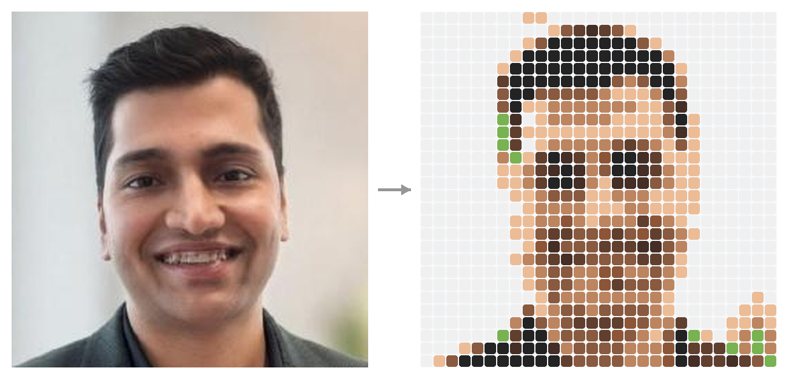

# github-emoji-portrait

Turn any photo into an emoji mosaic portrait for your GitHub profile README.



One Python file, one dependency (Pillow), zero config. Feed it a headshot, get back a grid of emoji squares that renders as a pixel-art portrait inside a code block. This is the same script that generated the portrait on [my profile](https://github.com/princejain756).

## Usage

```bash
pip install -r requirements.txt
python emoji_portrait.py photo.jpg > portrait.txt
```

Then paste the output into your profile README inside a fenced block:

    ```
    <paste here>
    ```

## Options

| flag | default | what it does |
|---|---|---|
| `--size` | 28 | mosaic width and height in emoji |
| `--crop` | 0.56 | how much of the frame to keep (smaller = tighter face crop) |
| `--top` | 0.04 | vertical offset of the crop, as a fraction of image height |

## Tips

- A centered headshot on a light background works best.
- 24–32 emoji is the sweet spot. Below ~20 faces stop being readable; above ~40 the README gets tall.
- If the face sits too low or too high, nudge `--top`.
- `--size 20 --crop 0.7` gives a decent avatar-style crop for wider shots.

## Why this exists

ASCII art portraits are everywhere; colored ones aren't. Emoji squares are the only "pixels" GitHub lets you color inside a code block, and the Fitzpatrick skin-tone swatches (`🏻🏼🏽🏾🏿`) happen to be a decent mid-tone ramp. The palette is hardcoded to the colors GitHub's emoji font actually renders, then every pixel snaps to its nearest swatch.

## License

MIT
